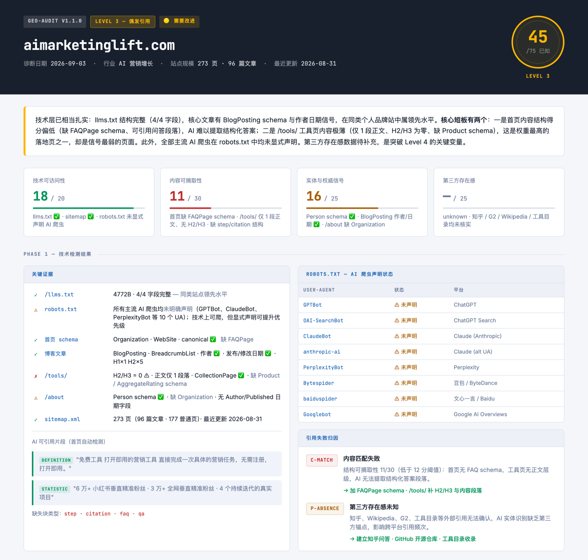

中文 | [English](README.en.md)

# geo-audit

**测一下你的网站，AI 搜索会不会引用它。**

一个开源的 Agent Skill。给它一个网址，它会检查 AI 爬虫能不能进来、内容好不好被摘取、权威信号够不够，告诉你为什么没被引用，以及这周先改什么。

覆盖 ChatGPT、Perplexity、Claude、Google AI Overviews，也覆盖 DeepSeek、豆包、文心一言、Kimi、通义千问。

传统 SEO 让你被排进搜索结果，GEO 让你被 AI 写进答案。

## 一行安装

```bash
npx skills add https://github.com/jiguang9/geo-audit --skill geo-audit
```

支持 Claude Code、Codex、OpenClaw、Hermes、Cursor、Windsurf。零依赖，只需要 Node 18+，不需要任何 API Key。

## 怎么用

装好后直接对你的 agent 说：

```
帮我做一次 GEO 诊断：https://你的网站
为什么 AI 不引用我的内容？
检查一下 [品牌] 在 AI 搜索里的可见度
```

不用先填问卷，给网址就开始跑。

## 报告长什么样

2026-09-03 用 geo-audit 诊断 [aimarketinglift.com](https://aimarketinglift.com)，诊断跑完后让 agent 把结果排版成 HTML 报告，下图是报告首屏：



> 这张图是 agent 排版的 HTML 版。直接在命令行运行 `tools/audit.js`，输出的是 Markdown 报告，默认只查首页和一篇文章页。工具页、/about 这类页面的抽查由 agent 按 skill 流程补做。

这次诊断的结论：

- **Level 3，偶尔被引用。** 已知部分 45/75。第三方存在感没给证据，记为 unknown，总分按 75 分算，不按 0 分扣，换算成百分制是 60 分。
- **技术可访问性 18/20。** llms.txt 四个字段齐全，sitemap 正常，但 robots.txt 里 10 个主流 AI 爬虫都没有显式声明。
- **内容可摘取性 11/30，是最大短板。** 首页缺 FAQPage schema 和可引用的问答段落，/tools/ 工具页只有 1 段正文，没有 H2/H3。
- **实体与权威信号 16/25。** 文章页有 BlogPosting、作者和发布/修改日期，/about 页缺 Organization schema。
- **引用失败归因两条。** C-MATCH（内容匹配失败）和 P-ABSENCE（第三方存在感未知），每条都附了修法。

每份报告包含：

- **总裁决**：🟢 可引用 / 🟡 需修复 / 🔴 被阻断。AI 爬虫被挡住时直接封顶，并显示封顶前的原始分
- **GEO 得分**：四个维度，每个都标置信度
- **关键技术证据**：robots.txt 里 10 个 AI 爬虫的放行情况、llms.txt、Schema 类型和缺失属性、文章页作者和日期、AI 最可能截取的句子
- **引用失败诊断**：自动判断属于哪一类引用障碍，每类给对应修法
- **P0 / P1 / P2 行动清单**：按本周、本月、持续排好优先级，附可复制的代码模板
- **推荐监控查询**：一组每月拿去各个 AI 平台测一遍的问题，填了行业会按行业补充

## 和一般的 GEO 工具有什么不同

- **国内 AI 平台不是附带的。** 检查 Bytespider（豆包）、baiduspider（文心一言）的爬虫规则，第三方存在感看知乎和百度百科，不只看 Wikipedia 和 G2。
- **不知道就说不知道。** 没有证据的维度记为 unknown，每个维度标置信度（● 高 / ◐ 中 / ○ 低），不靠猜凑满分数。
- **告诉你为什么没被引用。** 七类引用失败代码：爬不到（T-ACCESS）、没收录（T-INDEX）、内容不对题（C-MATCH）、没给出直接答案（C-ANSWER）、权威不够（A-AUTH）、内容过时（A-FRESH）、外部没人提（P-ABSENCE）。
- **诊断完能直接改。** 根据你的网站生成预填好的 llms.txt，JSON-LD 模板可以让 agent 直接写进你的代码仓库。
- **能长期跟踪。** 加 `--save` 保存快照，下次自动出趋势对比；也可以接 GitHub Action 每周跑一次，分数掉到线以下就报警。
- **中英文报告。** 默认中文，加 `--lang en` 出英文。

## 评分怎么算

| 维度 | 权重 | 看什么 |
|------|-----:|--------|
| 内容可摘取性 | 30 | 标题层级、FAQ、表格列表、能被单独引用的段落 |
| 实体与权威信号 | 25 | 外部引用、作者、更新时间、Organization Schema |
| 第三方存在感 | 25 | 知乎、Wikipedia、评测网站、媒体报道 |
| 技术可访问性 | 20 | robots.txt、llms.txt、Schema、canonical |

| 等级 | 分数 | 状态 |
|------|------|------|
| 1 | 0–20 | AI 爬虫被挡住或访问不到 |
| 2 | 21–40 | 能访问，但很少被引用 |
| 3 | 41–60 | 偶尔被引用 |
| 4 | 61–80 | 在多个平台稳定被引用 |
| 5 | 81–100 | 高频引用，权威性强 |

总分统一换算成 0–100 再定级，所以缺一个维度的报告也能和完整报告比较。

## 进阶用法

<details>
<summary><b>命令行直接跑</b></summary>

```bash
# 完整诊断，输出 Markdown 报告
node tools/audit.js https://example.com --brand "品牌名"

# 英文报告
node tools/audit.js https://example.com --brand "Brand" --lang en

# 保存快照，之后再跑同一个域名会自动出趋势表
node tools/audit.js https://example.com --save

# 输出 JSON，方便脚本或 agent 处理
node tools/audit.js https://example.com --json

# 根据网站生成预填好的 llms.txt
node tools/llms-txt-generator.js https://example.com > llms.txt

# 单项检查
node tools/sitemap-checker.js https://example.com
node tools/robots-checker.js https://example.com
node tools/llms-txt-checker.js https://example.com
node tools/schema-inspector.js https://example.com
node tools/content-structure.js https://example.com
```

| 参数 | 例子 | 说明 |
|------|------|------|
| `--brand` | `--brand "Acme"` | 报告里显示的品牌名 |
| `--industry` | `--industry SaaS` | SaaS / ecommerce / media / B2B / local |
| `--market` | `--market China` | China / US / global |
| `--lang` | `--lang en` | 报告语言，`zh`（默认）或 `en` |
| `--save` | `--save` | 快照存到 `.agents/geo-audit-history/` |

参数和网址的顺序随意。

</details>

<details>
<summary><b>补充背景信息（解锁第三方存在感和引用矩阵）</b></summary>

在你的项目根目录建 `.agents/geo-audit-context.md`（或 `.json`），每次诊断会自动读取：

```markdown
url: https://example.com
brand: Acme
industry: SaaS
market: global
platforms: ChatGPT, Perplexity, Google AI Overviews, DeepSeek, 豆包
queries: 最好的 X 工具, 怎么做 Y, X 和竞品对比
competitors: CompetitorA, CompetitorB
```

**第三方存在感**（填了才会给这 25 分打分）：

```markdown
presence: {"hasWikipedia": false, "hasBaiduBaike": false, "hasZhihu": true, "reviewPlatformCount": 2, "mediaMentionCount": 5, "socialPlatformCount": 3}
```

**引用实测结果**（填了会出"查询 × 平台"引用矩阵）：

```markdown
citationEvidence: [{"query": "最好的 X 工具", "platform": "ChatGPT", "brandMentioned": true, "officialUrlCited": false, "competitorsCited": ["CompA"]}, {"query": "最好的 X 工具", "platform": "豆包", "brandMentioned": false, "officialUrlCited": false, "competitorsCited": []}]
```

</details>

<details>
<summary><b>GitHub Action：每周自动诊断</b></summary>

分数低于门槛时让任务失败：

```yaml
# .github/workflows/geo-audit.yml
name: GEO Audit
on:
  schedule: [{ cron: '0 6 * * 1' }]   # 每周一
  workflow_dispatch:
jobs:
  audit:
    runs-on: ubuntu-latest
    steps:
      - uses: jiguang9/geo-audit@main
        with:
          url: https://example.com
          brand: 'Acme'
          min-score: 60        # 0 = 只出报告，不失败
          lang: zh
```

完整报告会写进任务的 Summary 页面。

</details>

<details>
<summary><b>更新</b></summary>

`npx skills add` 装的是普通文件夹（没有 `.git`），在 Codex 这类沙箱里 `git pull` 和 `npx` 都可能用不了。用自带的 `update.sh`，只需要 `curl` 或 `wget`：

```bash
bash ~/.claude/skills/geo-audit/update.sh   # Claude Code
bash ~/.codex/skills/geo-audit/update.sh    # Codex
```

路径按你实际的安装位置调整。脚本会依次尝试 `git pull`、`curl`、`wget`。

</details>

<details>
<summary><b>测试</b></summary>

```bash
npm test
```

用 Node 自带的 `node:test`，零依赖。覆盖 robots.txt 解析、llms.txt 校验、Schema 检查、内容结构识别、引用失败分类、引用矩阵和报告渲染。

</details>

## 安全边界

- 只抓取你给的公开网址，不扫 localhost、内网 IP 和 `.local` / `.internal` 域名
- 不绕过登录，不抓付费内容
- 每项检查最多发一次请求，不爬站
- 第三方平台的存在感由你提供证据，不去爬竞品或评测网站

## 同系列 Skill

| Skill | 做什么 |
|-------|--------|
| [google-seo-audit](https://github.com/jiguang9/google-seo-audit) | Google SEO 九个维度体检，含 Core Web Vitals 和 Search Console 数据 |
| [competitor-analysis](https://github.com/jiguang9/competitor-analysis) | 有证据的竞品分析、口碑分析和竞品内容拆解 |
| [industry-research](https://github.com/jiguang9/industry-research) | 快速摸清一个陌生行业的结构、商业模式和竞争格局 |
| [ai-marketing-hot](https://github.com/jiguang9/ai-marketing-hot) | AI 营销热点日报，每条都带营销影响和建议动作 |

## 关于作者

硅基光哥，做 GEO、AI 营销和出海获客。更多方法和实测在 [aimarketinglift.com](https://aimarketinglift.com)。

用得顺手的话点个 Star，遇到问题欢迎提 [Issue](https://github.com/jiguang9/geo-audit/issues)。

## License

MIT
